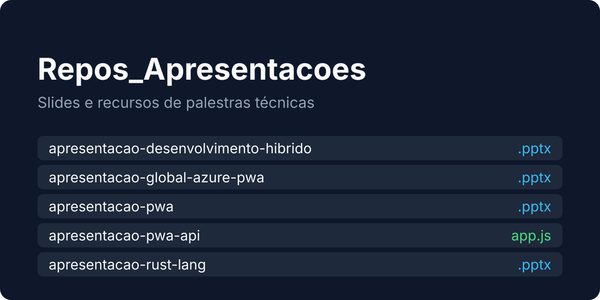
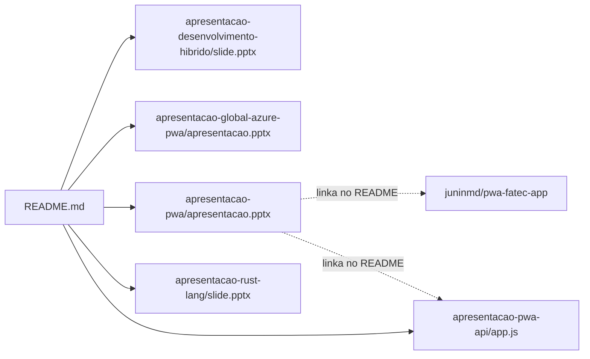

<div align="center">



# Repositórios de Apresentações

**Coleção de repositórios de slides e apresentações.**<br/>
Cinco pastas independentes com os slides em PowerPoint, as imagens usadas e, no caso do PWA, a API de votação da demo.

[](https://github.com/juninmd/Repos_Apresentacoes/actions/workflows/validate.yml)
[](#licença)


</div>

## Sobre

Este repositório agrupa materiais de apresentações técnicas sobre diversos temas, incluindo desenvolvimento híbrido, PWA, Rust, Azure, entre outros.

## Repositórios inclusos

Cada subpasta é um projeto de apresentação independente, com README próprio.

| Pasta | Tema | Conteúdo principal | Tamanho do arquivo |
|-------|------|--------------------|--------------------|
| [`apresentacao-desenvolvimento-hibrido/`](apresentacao-desenvolvimento-hibrido) | Desenvolvimento Híbrido (Ionic) | `slide.pptx`, imagens em `Recursos/` | 39 MB |
| [`apresentacao-global-azure-pwa/`](apresentacao-global-azure-pwa) | Global Azure + PWA | `apresentacao.pptx`, imagens em `imagens/` | 60 MB |
| [`apresentacao-pwa-api/`](apresentacao-pwa-api) | API para PWA | `app.js` (Express), `Procfile`, `package.json` | sem slides, só código |
| [`apresentacao-pwa/`](apresentacao-pwa) | Progressive Web Apps | `apresentacao.pptx`, imagens em `imagens/` | 33 MB |
| [`apresentacao-rust-lang/`](apresentacao-rust-lang) | Linguagem Rust | `slide.pptx`, logo em `recursos/` | 120 KB |

## Formato

As apresentações estão em formato PowerPoint (`.pptx`), acompanhadas de código e recursos relacionados. Não há versões em PDF. Baixe o arquivo da pasta desejada e abra no PowerPoint, Keynote ou LibreOffice Impress.

> [!NOTE]
> Os arquivos `.pptx` chegam a 60 MB. Para baixar apenas um deles, abra-o pela interface do GitHub e use **Download raw file**, em vez de clonar o repositório inteiro.

## Como se relacionam



O README de `apresentacao-pwa` aponta para o código do aplicativo de demonstração (`juninmd/pwa-fatec-app`) e para a API, que é a pasta `apresentacao-pwa-api`.

## API de votação

Única pasta com código executável. Requer Node.js e npm; as dependências são `express`, `cors` e `body-parser`.

```sh
cd apresentacao-pwa-api
npm install     # instala as dependências
npm start       # sobe a API em http://localhost:8050 (ou na porta de PORT)
```

| Rota | Efeito |
|------|--------|
| `POST /vote` com `{"id": 1..6}` | soma um voto à opção; outro `id` retorna 400 `Opção inválida.` |
| `GET /vote` | lista as opções com `id` e `votes` |
| `GET /reset` | apaga os votos |

Exemplo de resposta de `POST /vote` com `{"id":2}`, seguido de `GET /vote`:

```json
{"message":"Seu voto foi computado com sucesso."}
[{"id":2,"votes":1}]
```

| Variável | Propósito | Padrão | Exemplo |
|----------|-----------|--------|---------|
| `PORT` | porta HTTP | `8050` | `8051` |

## Limitações conhecidas

- Os slides são binários `.pptx`: o GitHub não renderiza nem mostra diferenças entre versões.
- A API de votação grava em `vote.txt` no diretório atual, não tem autenticação e expõe `GET /reset` a qualquer cliente. Serve só para demonstração, não para produção.
- Os README das subpastas ainda são rascunhos genéricos, exceto o de `apresentacao-pwa`.

## Documentação

| Documento | Conteúdo |
|-----------|----------|
| [AGENTS.md](AGENTS.md) | estrutura do repositório e regras para agentes e contribuidores |
| [docs/PROJECT_HEALTH.md](docs/PROJECT_HEALTH.md) | automações e plano de melhoria do repositório |
| [SECURITY.md](SECURITY.md) | política de segurança |

## Segurança

O workflow `security.yml` roda Gitleaks a cada push em `main` ou `master`. A política de divulgação está em [SECURITY.md](SECURITY.md).

## Licença

MIT. Copyright (c) 2026 Antonio Carlos. Veja [LICENSE](LICENSE).
